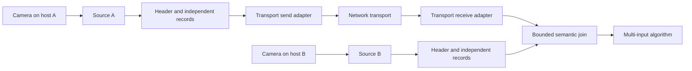
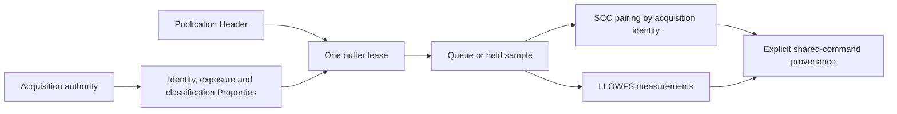
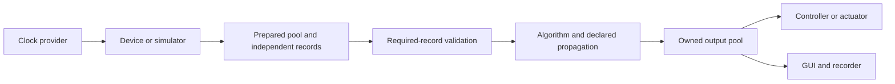

\page page_acquisition_metadata Acquisition identity and multi-host timing

# Acquisition identity and multi-host timing

## Status and authority

Native 3.0 implementation is in progress. The independent-record ABI below is
assigned and implemented in the native headers. The former native 2.0 Properties
contract is retained in this document as historical context; its runtime helpers
and acquisition keys are removed from the new cohort. Delivery gates remain
open until their recorded verification passes.

This document defines the PipeWireAO acquisition identity, timing, and join
contract. It applies to complete frames and to complete row-block ndarray
micro-buffers. It does not make the PipeWire scheduler a semantic join engine.

The key words **MUST**, **MUST NOT**, **REQUIRED**, **SHALL**, **SHALL NOT**,
**SHOULD**, **SHOULD NOT**, **RECOMMENDED**, **NOT RECOMMENDED**, **MAY**, and
**OPTIONAL** in this document are to be interpreted as described in BCP 14
(RFC 2119 and RFC 8174) when, and only when, they appear in all capitals.

`spa/include/spa/buffer/meta.h` is the ABI authority. This document is the
semantic authority. A transport profile defines its own encoding and carriage,
but it MUST NOT change these field meanings.

## System boundary

PipeWire graph scheduling answers when a runnable node may process. It does not
decide whether buffers from independent cameras describe the same physical
acquisition. That decision belongs to a bounded semantic join.



The same contract applies when both sources are local; the encode, transport,
and decode steps are then absent.

## Identity contract

The acquisition identity is the exact tuple:

```text
(domain, generation, sequence)
```

- `domain` is a nonzero, opaque 128-bit identifier for one acquisition or
  trigger authority.
- `generation` is a 64-bit epoch assigned by that authority.
- `sequence` is the 64-bit acquisition number within that generation.

**ACQ-ID-001:** Producers that claim a shared identity domain **MUST** receive
`domain` and `generation` from the same control-plane authority and **MUST**
derive `sequence` from the same physical trigger or acquisition counter.

Verification: configure two simulated hosts with the same authority values and
prove that equal physical acquisitions compare equal while a changed domain,
generation, or sequence compares unequal.

**ACQ-ID-002:** A producer **MUST NOT** advance a shared generation because of
its own pause, restart, packet loss, or local process lifecycle. Before a
sequence can reset, wrap, or be reused, the authority **MUST** distribute a new
generation to every participant. If the producer observes a non-increasing
sequence for a newly completed physical acquisition without that reconfiguration,
it **MUST** fail closed and stop publishing valid identity. Re-publication of a
retained acquisition preserves its identity; a new publication Header does not
claim a new physical acquisition.

Verification: inject a duplicate or reset sequence and prove that the producer
does not publish a new locally invented identity tuple.

Exact identity is independent of clock synchronization and is the preferred
join key. A profile may select qualified time as a fallback when counters are
not shared, or as a consistency check. Clock domains, event conventions and
uncertainty must satisfy the current independent-record timing contract; PTP is
not a base-framework dependency.

## Historical native 2.0 per-buffer representation

Native 2.0 implements this representation. The preceding 1.7.3 cohort used
the superseded Acquisition record. The replacement is standard `SPA_META_Header`
and the existing `SPA_META_Properties` BufferProperties Object, version 1.
Metadata IDs 11 and 12 remain retired and MUST NOT be reused. No Acquisition
version, compatibility reader, or version-selection flag remains in the new
runtime cohort. This changes the ndarray callback ABI and requires a coordinated
native/bindings/application release; it is not an SDK replacement for old clients.

The native Header retains publication sequence, presentation time and lifecycle
flags. Acquisition identity and exposure facts are independent Properties.
A held sample retains its acquisition tuple while each publication advances
Header sequence and presentation time. Equality of these sequence numbers is
not a general metadata invariant. Header PTS MUST NOT substitute for physical
exposure start.

The following keys extend the existing Object without changing existing keys or
the Object version. POD Bytes containing an unsigned integer use exactly eight
little-endian bytes, covering the entire UInt64 range. They are values inside a
native POD Object, not a cross-host encoding of the whole Object.

| Key | Name | POD type | Meaning |
| --- | --- | --- | --- |
| 1 | `opticalClassification` | Id | Independent absent/unfringed/fringed/mixed optical fact, values 0/1/2/3 |
| 2 | `triggerClassification` | Id | Independent absent/low/high/mixed electrical fact, values 0/1/2/3 |
| 3 | `acquisitionDomain` | Bytes16 | Nonzero acquisition-authority identifier |
| 4 | `acquisitionGeneration` | Bytes8 | Full unsigned authority generation |
| 5 | `acquisitionSequence` | Bytes8 | Full unsigned physical acquisition counter |
| 6 | `exposureDuration` | Bytes8 | Positive duration in nanoseconds |
| 7 | `exposureStart` | Long | Nonnegative physical exposure start in nanoseconds |
| 8 | `exposureTimebase` | Id | MONOTONIC=1 or TAI=2 |
| 9 | `timestampUncertainty` | Bytes8 | Inclusive unsigned timestamp error bound in nanoseconds |
| 10 | `ptpGrandmasterIdentity` | Bytes8 | Nonzero IEEE 1588 clock identity, preserving byte order |
| 11 | `ptpDomainNumber` | Id | IEEE 1588 domain, 0 through 255 |

**ACQ-ABI-001:** A producer MUST initialize every reused Properties allocation
before adding facts. A consumer MUST validate the complete Object before
interpreting it. Properties retain their existing 16–4096-byte, eight-byte-aligned,
64-field bounds, strict key order, exact types/sizes, zero padding and tail rules.
The ndarray aggregate metadata budget remains 4096 bytes, including Header.

**ACQ-PROP-001:** Keys 3–11 MUST carry `SPA_POD_PROP_FLAG_MANDATORY` when
present. Unknown well-formed optional keys MUST remain skippable. Unknown
mandatory keys MUST fail admission unless a consumer requirement declares
understanding. Each consumer MUST declare the facts and exact POD types it
requires; absent required keys and wrong types/sizes MUST fail before use.
Container-version support alone does not promise a particular fact is present.

**ACQ-PROP-002:** Identity keys 3–5 MUST appear together or all be absent.
Exposure-start keys 7–9 MUST appear together or all be absent. Duration is
independent. TAI additionally requires keys 10–11 with a nonzero grandmaster;
MONOTONIC MUST NOT include PTP keys. PTP keys without a start are invalid.
Classification absence differs from a present absent-classification value.
Partial groups and invalid ranges MUST fail complete-record validation.
Private builders may append a group incrementally; incomplete objects MUST NOT
be published or accepted by readers. Append helpers perform structural checks
while complete validation also checks semantic groups.

**ACQ-PROP-003:** Unchanged pass-through MUST preserve all validated Properties,
including unknown optional fields, under the original buffer lease. Derived
outputs MUST use explicit scientific provenance; a sum MUST NOT invent one
camera's identity for the combined command. Output reuse MUST clear stale facts.
Header publication identity and retained acquisition identity MUST remain distinct.

**ACQ-TRIGGER-001:** Trigger Id values **MUST** classify the electrical state over
the whole exposure. Optical classification MUST NOT be inferred from electrical
polarity by a generic transport. An optical application relating them MUST supply
its explicit mapping, including absent and mixed states.

**ACQ-TRIGGER-002:** Chopped pairing MUST require complete acquisition identity,
positive duration and explicit usable optical classification. It MUST validate
same authority/generation, adjacent acquisition counters, compatible duration,
and alternating fringed/unfringed roles. Duplicates, stale records and gaps
MUST follow the existing bounded SCC reset/rejection policy, independently of
Header publication counters. Missing metadata MUST NOT be reconstructed from
arrival order or from a missing property treated as zero.

**ACQ-TRIGGER-003:** The new cohort MUST neither negotiate nor publish the retired
metadata type 11. Old-schema-only peers MUST fail required-Properties negotiation
or semantic admission, rather than silently running with missing identity/timing.

Verification: full-range unsigned round trips; malformed types/sizes/flags,
partial groups and padding; buffer reuse; required-key rejection; held-sample
publication/acquisition divergence; all electrical/optical classifications;
and chopped loss/restart/duplicate tests. Native callbacks expose borrowed
Properties and Header, without the old by-value Acquisition record.

### Public native helper vocabulary

`spa_acquisition_identity` and `spa_exposure_start` are owned semantic values,
not separately versioned wire records. `spa_meta_properties_get_acquisition_identity`,
`spa_meta_properties_get_exposure_start` and
`spa_meta_properties_get_exposure_duration` read validated facts.
`spa_meta_properties_add` accepts explicit property flags;
`spa_meta_properties_add_uint64` and `spa_meta_properties_get_uint64` implement
the eight-byte unsigned representation. `spa_acquisition_identity_equal`,
`spa_exposure_start_time_difference` and `spa_exposure_start_times_match` preserve
the identity, clock and saturating comparison rules below. No old-name aliases
are introduced.

## Historical native 2.0 PTP-qualified time

A cross-host exposure timestamp has all of these properties:

- `exposureStart` is the physical exposure start expressed as
  nonnegative Linux `CLOCK_TAI` nanoseconds;
- `timebase` is `TAI`;
- the complete exposure-start and PTP property groups are present;
- `ptpGrandmasterIdentity` is the nonzero IEEE 1588 grandmaster clock identity;
- `ptpDomainNumber` is the IEEE 1588 domain number; and
- `timestampUncertainty` is a conservative inclusive error bound.

**ACQ-TIME-001:** A producer **MUST** use
the TAI exposure-start property group only when the device timestamp
is traceably mapped to `CLOCK_TAI`. The mapping **MUST** account for the PTP
timescale and UTC offset. A disciplined `CLOCK_MONOTONIC`, host arrival time,
buffer completion time, or unqualified device tick is not a substitute.

Verification: compare the reported exposure time against a qualified hardware
timestamp source while exercising the configured PTP profile.

**ACQ-TIME-002:** `timestampUncertainty` **MUST** bound device timestamp
resolution, exposure-latch error, device-to-PHC conversion error, PHC-to-TAI
correlation error, and the accepted synchronization error. If no defensible
bound is available, the producer **MUST NOT** publish a PTP-qualified group.

Verification: measure each error term or obtain a guaranteed bound, record the
sum used by the producer, and test the bound during steady state and recovery.

**ACQ-TIME-003:** A producer **MUST** stop publishing PTP-valid time after loss of
synchronization, an unbounded clock step, an unknown UTC offset, or an unqualified
grandmaster change, and **SHOULD** mark the next recovered output
`SPA_META_HEADER_FLAG_DISCONT`.

Verification: inject each loss condition and prove that no PTP-valid record is
published until qualification recovers.

Two exposure-start values are comparable only when both records validate, both
are PTP-qualified TAI values, and their grandmaster identities and PTP domain
numbers are byte-for-byte equal. The helper
`spa_exposure_start_time_difference()` enforces these preconditions and
returns:

```text
difference = exposure_start_a - exposure_start_b
combined_uncertainty = saturating_add(uncertainty_a, uncertainty_b)
```

Host location, clock servo name, and similar wall-clock readings are not part
of the comparison.

## Historical native 2.0 Join contract

**ACQ-JOIN-001:** A join **SHOULD** match an exact acquisition identity first.
It **MAY** use PTP time when identity is absent, or use it to reject an
identity match that violates a configured physical-time bound.

**ACQ-JOIN-002:** A time-based join **MUST** choose an application-specific
additional tolerance `T` and may match only when:

```text
abs(difference) <= combined_uncertainty + T
```

The addition is saturating. `spa_exposure_start_times_match()` implements
this test. `T` does not replace the reported uncertainty and **SHOULD** be less
than half the minimum acquisition interval so adjacent acquisitions cannot
match under nominal conditions.

**ACQ-JOIN-003:** A join **MUST** have bounded per-input storage, a deadline,
and an explicit policy for missing, late, duplicate, and ambiguous inputs. The
policy may drop, hold the last value, or emit an incomplete result, but a
non-real-time input **MUST NOT** retain an unbounded number of RTC buffers.

Verification: cover exact matches, different identity fields, matching and
different PTP authorities, the uncertainty boundary, adjacent acquisitions,
duplicates, missing inputs, reordering, deadline release, and overload.

## Historical native 2.0 Transport boundary

SPA metadata is native shared-memory state. PipeWire does not serialize it
across hosts, and an application MUST NOT send the bytes of the native C
structure as a network protocol. The network adapter is the correct owner of
transport versioning, byte order, framing, authentication, and association
with fragmented payload data. No transport codec is exposed by the core SPA
metadata API until a concrete transport profile requires one.

**ACQ-WIRE-001:** A cross-host adapter **MUST** carry one acquisition record with
the corresponding payload according to its transport profile and **MUST**
preserve their association through loss, reordering, duplication, and
fragmentation. It **MUST NOT** copy the native C structure directly onto the
wire.

**ACQ-WIRE-002:** A receiving adapter **MUST** decode the transport record,
construct native metadata through the public Properties helpers, and validate
it before publishing local Header and Properties. Invalid or missing records
**MUST NOT** be synthesized from packet arrival time.

Verification belongs to the selected transport implementation. It must include
golden vectors and round trips on both endian architectures where available,
then exercise loss, reordering, duplication, fragmentation, and malformed
records.

## Historical native 2.0 Capability and migration gates

Hardware PTP qualification and cross-host codecs are not established by local
SPA transport tests. Device adapters must migrate their producers separately
before using the new runtime cohort; missing facts cannot be manufactured.

| Gate | Required evidence | Status |
| --- | --- | --- |
| Semantic and native contract | Identity/range/clock/hold rules and additive keys reviewed | Reviewed; native boundary independently reviewed |
| Native transport and queues | No retired record IDs; private-core Properties preservation, mismatch/reuse/fanout tests | Native focused tests and 17 queue tests pass |
| Julia and Rust bindings | Regenerated ABI; no version selection or legacy transport readers | Rust and Julia unit/private-core tests pass; regenerated ABI reviewed |
| Scientific algorithms and HIL | Version-free chopping, joins, commands and held identities; zero-allocation warmed transport | Semantic and private-core tests pass, including required extensions, held/captured retention and warmed zero allocation |
| RTC, capture, GUI and applications | New-schema-only source→queue→RTC→DM→GUI/capture, cold schemas and pins updated | Capture and GUI tests pass; all four instrument cold exports pass |
| Retirement | Independent review, old-schema rejection, full dependency-cohort validation and release | Independent review complete; packaged native tests pass; publish only the complete staged cohort |

## Historical native 2.0 Delivery plan and identifier preflight

Native baseline `15525f80f`, PipeWireAO.jl `687d420`, JFG `68df2f5`, HIL `d676abc`,
RTC `f7923eb`, Rust `e362a2c`, queue plugins `975c553`, GUI `a7ea558`, and instrument
monorepo `37dc272` are isolated on `codex/metadata-migration` worktrees. Pre-existing
checkouts and running unrelated sessions remain untouched. Simulators and GUI
for this work remain stopped; integration uses private cores and bounded fixtures.

The dependency order is native helpers/callback ABI and queues, regenerated
Julia/Rust bindings, scientific adapters and HIL, then RTC/GUI/capture and authored
instrument configuration. Only a complete validated replacement cohort is
published; no v2 intermediate is a delivery. Frozen scientific calibration bytes
and historical capture bytes are not hand-edited. Raw logs/builds are temporary.

The following flow preserves publication and acquisition as separate facts:



| Vocabulary | Authority and scope |
| --- | --- |
| Header, Properties, POD Id/Long/Bytes, mandatory flags | Adopted SPA metadata/POD boundary; existing Object contract |
| acquisition domain/generation/sequence | ACQ-ID-001/002; full-width physical authority identity |
| exposure start/duration, uncertainty, PTP grandmaster/domain | ACQ-TIME-001/002/003 and existing IEEE 1588 qualification semantics |
| optical/trigger classifications | Existing independent key 1/2 contract; no inferred mapping |
| publication sequence | Standard Header plus established held-sample contract; not an acquisition alias |

Existing ACQ-ID/TIME/JOIN/WIRE requirement identities and meanings remain intact.
ACQ-ABI and TRIGGER clauses now define the replacement boundary; ACQ-PROP clauses
make extensibility and complete semantic groups explicit. The native header is
implemented against this authority, not used to invent competing terminology.

The complete software cohort is native/JLL 2.0.0, PipeWireAO.jl 0.7.0,
FGA 0.9.0, JFG 0.5.0, FGPW/FI 0.2.0, HIL/RTC 0.3.0. Independent review
findings on required-field admission and opaque-field retention were reproduced,
fixed and reviewed again. Packaged native validation passes 171 binding and
1,632 HIL calibration assertions without SDK preferences. ARM build/hash/header
checks do not establish ARM runtime qualification.

## Independent SPA metadata records

### Decision and applicability

Target design, 2026-11-02; native implementation in progress. This section owns
the framework-wide metadata migration plan for every PipeWireAO RTC, device
adapter, simulator, algorithm executor, observer and recorder. SPIDERS and CAL2
are acceptance applications, not definitions of the generic boundary.

Replace acquisition facts inside the single BufferProperties Object with
independently typed `spa_meta` entries alongside standard `SPA_META_Header`.
Add a new metadata type to add a new semantic capability; do not extend a
universal acquisition record or introduce a global acquisition version selector.
Absolute REALTIME or TAI timestamps are part of telemetry support. PTP is not
a dependency of the base framework; a future clock provider may qualify clocks.

The requirements below are target obligations using the BCP 14 convention
declared above. They do not claim current conformance. Earlier ACQ-ID identity
rules remain applicable. Existing ACQ-ABI/PROP/TRIGGER/TIME/JOIN/WIRE clauses describe
the historical native 2.0 cohort. The assigned ABI section reconciles them
explicitly while retaining their IDs and history. Current delivery evidence does
not promote historical gates into whole-framework native 3.0 conformance.

Non-goals: implementing a network transport, clock discipline, hardware PTP,
new scientific estimators, new controller authority, or physical/deadline
qualification. Keep simulation and GUI sessions stopped during this migration;
private-core integration tests own and close their cores.

### Record boundaries and terminology

These are semantic record descriptions, not assigned C type names or numeric
IDs. Native headers will own the final ABI and generated bindings will follow.

| Record | Coherent contents and meaning | Applicability |
| --- | --- | --- |
| Standard SPA Header | Existing presentation timestamp in ns, sequence, flags and decoding offset; PTS alone does not declare an absolute epoch or clock | Base framework stream profile |
| Acquisition identity | Existing nonzero authority domain, full UInt64 generation and sequence; retained exposures keep their identity | Acquisition products and consumers needing association |
| Exposure timing | Exposure interval, stated start/end convention, units and clock domain; source timing is distinct from queue arrival | Integrating sensors and algorithms needing exposure coverage |
| Absolute time | Integer timestamp, REALTIME or TAI basis, event meaning, validity and provenance of any clock mapping | Recorded telemetry; optional on other ports |
| Optical chopping | Whole-exposure absent/unfringed/fringed/mixed optical classification, independent of electrical state | Chopped optical producers and consumers |
| Electrical trigger | Existing absent/low/high/mixed whole-exposure electrical classification | Trigger-aware producers and consumers |

Split by semantic unit, not one metadata type per scalar. Do not put unrelated
instrument settings, calibration arrays, node properties or recording filenames
in these records. Existing product/command provenance stays explicit; combined
outputs cannot be represented by arbitrarily selecting one camera's identity.
Phase 1 inventories existing contributor/feedback lineage before assigning ABI
layouts; it must preserve those semantics without inventing an unbounded history.

### Assigned native ABI and port declaration

The custom registry reserves `0x300..0x3ff` for PipeWireAO. Initial layouts use
`0x300` AcquisitionIdentity, `0x301` ExposureTiming, `0x302` AbsoluteTime,
`0x303` OpticalChopping and `0x304` ElectricalTrigger. IDs 11, 12 and 13 remain
retired and are rejected. Upstream standard types retain their numeric values.
Every payload address is eight-byte aligned. These exact sizes are the initial
layout; an incompatible layout requires a new type ID. Native bytes are not a
network encoding.

| C record | Size | Fields in order |
| --- | ---: | --- |
| `spa_meta_acquisition_identity` | 40 | UInt32 flags/reserved; domain[16]; UInt64 generation/sequence |
| `spa_meta_exposure_timing` | 64 | UInt32 flags/clock; clock_domain[16]; mapping[16]; Int64 start_nsec; UInt64 duration_nsec/uncertainty_nsec |
| `spa_meta_absolute_time_event` | 80 | Int64 seconds; UInt32 nanoseconds/clock/event/flags; origin[16]; clock_domain[16]; mapping[16]; UInt64 uncertainty_nsec |
| `spa_meta_absolute_time` | 336 | UInt32 count/reserved[3]; four absolute-time events |
| `spa_meta_optical_chopping` | 8 | UInt32 flags/classification |
| `spa_meta_electrical_trigger` | 8 | UInt32 flags/classification |

Identity and classifications use `SPA_META_RECORD_VALID=1`; all-zero storage
means allocated but invalid. Invalid payloads and reserved bytes MUST be zero.
Classification zero with VALID set means an explicit whole-exposure absent
classification. Identity requires a nonzero domain and retains the full unsigned
64-bit generation and sequence.

Exposure flags are START_VALID=1, DURATION_VALID=2, UNCERTAINTY=4 and MAPPED=8.
Duration alone is usable without a start. A valid duration is positive. Start
is the start of the half-open interval `[start, start + duration)` in nanoseconds
on the identified clock; its clock domain is nonzero. Unavailable fields are
zero. A mapped start requires a nonzero mapping ID. Clock values are MONOTONIC=1,
REALTIME=2, TAI=3 and MODEL=4. A signed start is deliberate; arithmetic involving
duration or differences must be checked before conversion or addition.

Absolute time uses signed epoch seconds and normalized nanoseconds 0..999999999;
it never passes through floating-point seconds. Only REALTIME and TAI are allowed.
Each active event has VALID=1, optional UNCERTAINTY=2, MAPPED=4 and CLOCK_STEP=8;
its origin and clock domain are nonzero. A nonzero uncertainty requires its flag;
MAPPED requires a nonzero mapping ID. CLOCK_STEP reports a discontinuity and does
not assert synchronization. Events are ACQUISITION=1, PRODUCTION=2, RECEIPT=3 and
FILE_WRITE=4. Active events occupy the first `count` entries; the remaining entries
are zero. At most four events are active, and `(event, origin)` is unique. A
required AbsoluteTime allocation with any valid event does not satisfy a profile
that requires a particular source event or basis; that profile checks both.
Source events survive derived publication. Recorder observations use a separate
index or sidecar, as specified above.

The cold Header PTS property registry is `PW_KEY_HEADER_PTS_CLOCK` =
`pipewireao.header.pts.clock` and `PW_KEY_HEADER_PTS_ABSOLUTE_CONVERSION` =
`pipewireao.header.pts.absolute-conversion`. Clock values are the lowercase strings
`monotonic`, `realtime`, `tai`, `model` or `unavailable`. Generic standalone and
filter-graph nodes default to `unavailable` for both properties. A cold producer
profile may identify its actual known clock. Conversion `unavailable` means no
validated mapping from Header PTS to a physical event is exposed; knowing a clock
label or numeric epoch still does not infer an acquisition event. The base
framework defines no Header conversion protocol. Per-buffer clock-domain and
event facts remain in the independent timing records.

Native 3.0 removes the duplicate by-value Header and Properties callback from
ndarray callback ABI 5. Header is the canonical entry in the borrowed `metas`
array. `spa_meta_records_find` locates a record without allocating. Inputs are
read-only and all descriptors are immutable for the lease. Output owners may
modify payload bytes, never counts, pointers, types or capacities. Native plugin
ABI 8 similarly extends `spa_fgn_port_info` with cold metadata declarations.

`spa_meta_requirement` has four UInt32 fields: type, exact size, flags and
reserved. REQUIRED=1 is the only flag; reserved is zero. Each cold frame-port
constructor carries the additional descriptor array, count and propagation mode
(PRODUCE=0, PRESERVE=1, REPLACE=2 or DROP=3). Header is required implicitly on both frame and sparse Parameter streams;
generic profiles declare no other records. Parameter Header sequence identifies
the published prepared product and never manufactures acquisition identity. The constructor copies standalone
filter declarations. PRESERVE requires output capacity for every accepted input
layout and makes those output allocation slots required even when their facts
are optional or invalid. Plugin declarations remain immutable for plugin lifetime.
The graph allocates each declared layout before activation. Existing bounded
contributor/feedback lineage remains in its algorithm owner; no native history
container is introduced.

`SPA_PARAM_META_required=0x1000000` is a local Bool on ParamMeta. The allocator
reads both peers' raw declarations before accepting negotiated storage, checking
required type and exact size independently of the standard 32-bit metaType mask.
The required Bool is removed from the value-intersection filter: optional supply
and required consumption are compatible. Custom types require explicit metadata
support on both peers. Unknown optional payloads remain opaque; a custom required
declaration explicitly asserts understanding of that specific type/layout. Unknown
or old peers cannot satisfy required custom layouts through a missing Meta param.
The standard mask remains available for upstream standard metadata below bit 32.
Feature entries count toward the 64-entry bound. When either peer fixes the
application/ndarray format, the allocator also rejects aggregate storage above
4096 bytes before pool allocation. Preparation does not imply that
required semantic facts are valid on a particular buffer.

`spa_meta_type_is_transport_owned` identifies Busy, SyncTimeline and feature
entries. Generic fact initialization is a no-op for those entries; copying and
owned snapshots omit their payloads and preserve each pool's synchronization
state. Borrowed descriptor iteration may expose them without reading mutable
payloads. This is an upstream ownership obligation, not a scientific fact.

`spa_meta_record_layout_validate(type, size, max_bytes)` is the shared pure
cold layout check. Core allocation uses the finite SPA Int size limit, preserving
upstream variable-sized metadata outside the ndarray profile.

`spa_meta_records_layout_validate` checks bounded storage independently of reused
bytes. `spa_meta_record_init` clears an owned slot. `spa_meta_record_validate`
checks understood semantics, with an optional valid-fact requirement.
`spa_meta_records_validate` checks the complete array and declared requirements;
unknown optional records are skipped. `spa_meta_records_copy` preflights all
storage and capacity before changing destination bytes, preserving every source
fact record exactly. Missing destinations, unequal sizes and aliasing reject the copy;
no truncation occurs. Opaque types participate without changes to generic iteration.

The replaced ACQ-ABI/PROP/TRIGGER/TIME/JOIN/WIRE clauses above retain their IDs and
native 2.0 history. ACQ-META-001..008 and ACQ-META-TIME-001..005 are the active
replacement requirements; identity authority rules ACQ-ID-001/002 still apply.
PTP-specific historical helpers are removed. No native TAI label claims hardware
qualification, and no base-profile clock discipline is introduced.

### Planned port and buffer contract

**ACQ-META-001:** Each supported framework stream MUST carry standard Header
metadata. Additional record types MUST be independently negotiable. Producers
MUST NOT represent the target acquisition facts through the released Properties
key groups or an Acquisition v1/v2/v3 compatibility record.

**ACQ-META-002:** A port MUST declare required record types/layouts and the
optional types it can supply or accept. Preparation MUST reject an unsatisfied
required capability before admission. A consumer MUST validate required records
on every buffer; negotiated allocation alone MUST NOT imply valid information.
Missing/invalid required facts MUST reject that input before scientific use.
Application policy owns hold/drop/fault behavior; rejection must not publish an
apparently valid result or partially advance scientific state.

**ACQ-META-003:** Buffer pools MUST allocate bounded record storage during
preparation. Initial limits are at most 64 metadata entries and 4096 aggregate
metadata bytes, including Header, alignment and feature entries, for the ndarray
profile. Other profiles MUST state finite limits explicitly. Adding a type or
increasing capacity beyond the negotiated layout MUST require a cold pool
replacement/renegotiation, not mutation of a borrowed buffer skeleton.

**ACQ-META-004:** A producer MUST initialize each owned output record on reuse
and explicitly mark unavailable facts invalid. Missing metadata, allocated but
invalid metadata, and a valid explicit absent-classification value MUST remain
distinguishable. Each proposed record layout MUST define its validity encoding,
reserved-byte rules and validation before bindings are generated. Duplicate
instances of a singleton record MUST be rejected.

**ACQ-META-005:** Published fact metadata MUST remain immutable for its buffer lease.
Standard transport-owned metadata, including Busy counters and SyncTimeline state,
MUST follow upstream ownership and synchronization rules; fact propagation,
initialization and owned snapshots MUST NOT clear or clone that state.
Only the owner of a writable output may populate or invalidate its fact records.
Consumers MUST NOT retain borrowed views beyond the callback/lease. Fanout
MUST NOT permit one consumer to remove or mutate another consumer's records.

**ACQ-META-006:** A node MUST declare record propagation as preserve, produce,
replace or drop. Unchanged pass-through MUST preserve accepted unknown optional
records byte-for-byte when their negotiated storage is available. A transform
MUST preserve only facts that remain true and MUST explicitly describe derived
output provenance. Required downstream records that would be dropped or cannot
fit MUST fail preparation; unexpected runtime overflow MUST reject publication,
without truncation or silent fallback. All paths MUST clear stale output facts.

**ACQ-META-007:** Required types/layouts MUST be supported explicitly; unknown
optional types MUST be skippable within negotiated bounds. Generic native
validation MUST check envelope/count/size/alignment bounds; validation of an
understood type MUST additionally check its flags, validity and semantic rules.
Unknown optional payloads remain opaque bytes under declared pass-through. Core
iteration MUST NOT depend on a hard-coded switch over every possible type.
Incompatible evolution MUST affect the specific type/layout, not every record.

**ACQ-META-008:** Optical and electrical classifications MUST remain independent.
Only a producer with an explicitly configured physical mapping may derive
optical classification from an electrical observation. Mixed-exposure and
missing/invalid chopping cases MUST NOT be treated as ordinary unfringed input.
Existing full-width identity, duplicate, generation and held-publication rules
MUST remain intact through the change.

Adding/removing valid information means populating or invalidating negotiated
record slots. It does not mean changing `n_metas`, sizes or pointers per frame.
Nodes producing a different metadata set use their own negotiated output pool.

### Timing and recording

**ACQ-META-TIME-001:** Standard Header PTS MUST retain its presentation-timeline
meaning. Neither acquisition identity nor physical event time may be inferred
from it. The stream profile MUST identify its PTS clock domain/epoch or declare
that absolute conversion is unavailable. Host scheduling/deadline measurements
MUST use a suitable monotonic clock independently of absolute recording time.

**ACQ-META-TIME-002:** The framework MUST support absolute-time records in
REALTIME and TAI, with integer seconds/nanoseconds or a checked Int64 nanosecond
representation, an explicit epoch/time scale and an explicit event meaning.
The native ABI design MUST choose one representation and verify its range and
cross-language layout before implementation. REALTIME means POSIX epoch time;
TAI means the system TAI time scale with its required offset correctly configured.
Neither label alone asserts synchronization or an accuracy bound. Reading the
clock MUST NOT pass through floating-point seconds.

**ACQ-META-TIME-003:** Telemetry recording profiles MUST require absolute time
for each recorded product and declare its event convention. REALTIME is the
default; TAI is an explicit selection. Acquisition, output production, receipt
and file-write time MUST NOT be interchangeable. A recorder MUST preserve source
event time and identity; any recorder observation time is separate provenance.
If source absolute time is unavailable, a profile may explicitly select recorder
receipt time, but MUST label that event and unavailable source time rather than
silently manufacture a source timestamp. Non-recording ports need only the
records required by their algorithms.

Recorder receive/write observations belong in its bounded recording index or
sidecar, not a mutation of the borrowed source buffer. Phase 1 must state each
record's multiplicity: acquisition identity, exposure interval and each
classification are singletons. Absolute-time event/origin multiplicity must be
bounded explicitly so preserving source time and describing a derived product's
own event never requires ambiguous duplicate singleton records. A reference to
source time in existing bounded provenance is allowed; silent replacement is not.

**ACQ-META-TIME-004:** A producer MUST identify any mapping from a
device/model/host clock to absolute time and its validity. It MUST NOT claim physical
acquisition timing from callback arrival. Explicit uncertainty is required when
a consumer relies on a quantitative accuracy bound. Clock steps, invalid TAI
configuration and invalid mappings MUST be observable; absolute clock jumps
MUST NOT reset acquisition identity, reorder acquisitions, or control deadlines.
Simulation/model time MUST remain distinguishable from execution wall time.

**ACQ-META-TIME-005:** Cross-clock comparisons MUST require the same identified
clock domain or an explicit applicable mapping with accuracy adequate for the
consumer's configured tolerance. REALTIME/TAI labels on different hosts MUST NOT
by themselves establish that condition. PTP-specific fields and clock discipline
MUST NOT be required by the base profile. A future PTP provider may add a separate
qualification record without modifying existing records. RTP/RTCP adapters own
their timestamp mapping; an RTP counter is not an absolute acquisition time.

### Ownership and flow

The producer owns event facts; the graph owns transformations; recording owns
storage and its own observations. The following diagram is informative.



Observers must keep their existing bounded, non-gating ownership. Optional
recording does not gain control-path leases or new RTC lifecycle authority.

### Implementation order and gates

Baseline: native `8bccb6e22`, PipeWireAO.jl 0.7.1/native-JLL 2.0.0,
FGA 0.9.0, JFG 0.5.0, FGPW/FI 0.2.0, HIL/RTC 0.3.0. RTC main also contains
`b867976` settings/shutdown fixes, which have not been released. Scientific
AOS 0.3.18/AOC 0.17.3/Proper 0.4.1 and frozen calibrations remain unchanged.

| Phase | Owner and likely surfaces | Exit gate |
| --- | --- | --- |
| 1. ABI and negotiation | Native `spa/buffer/meta.h`, type descriptions, `src/pipewire/buffers.c`, ndarray port/helper API; reconcile this document and native traceability | Reviewed record layouts, validity, event/clock enums, compatible-size rules, type IDs, finite limits and port contracts; allocator proof for required custom types and optional opaque pass-through |
| 2. Native vertical slice | Native filters/queues and SPA plugin image helpers | Header + absolute time + optional identity/chopping through producer, queue, consumer and fanout; negative admission/reuse/overflow tests; unsupported old ABI rejected |
| 3. Language boundaries | Native JLL; PipeWireAO.jl generated `LibPipeWire`, buffer/stream/ndarray APIs; Rust sys/high-level bindings | Same golden layouts/bytes and failure semantics; borrowed lifetimes; private-core round trips; zero warmed metadata heap allocation |
| 4. Algorithms and sources | FGA, JFG/FGPW/FI, AOS/HIL adapters, device plugins and graph warmup/capture | Chopped pairing, independent sensor arrivals, held/captured samples, row-block paths, shared command lineage and reset preserved; source timestamp conventions documented |
| 5. RTC and observation | RTC owners/export/configuration/calibration capture; GUI native/browser bridge and FITS/recording paths | Required metadata resolves in cold schemas; both absolute clocks record correctly; clocks remain labelled; no lost/forged source provenance or unknown optional pass-through |
| 6. Applications and release | All supported RTC profiles, including explicit inventory/disposition of Copper's older cohort | Fresh CPU/captured-GPU applications, matching dependency cohort, capture/GUI schemas, independent review and complete release/pin update; retired compatibility paths removed |

The native 2.0 allocator represented required metadata with a 32-bit mask and
reserved low numeric IDs. Native 3.0 adds the raw-peer ParamMeta requirement
check described above; custom types no longer consume standard mask bits.
Focused allocation tests cover that boundary and retain upstream standard
metadata support. IDs 11/12/13 remain retired. No per-instrument negotiation
protocol is introduced.

The assigned native layout is the ABI authority for generated bindings. Byte
counts, numeric type IDs and public helpers are implemented and covered by
focused native tests; cross-language integration and release gates remain open
until their own evidence is recorded.

Use one coordinated breaking native/binding/dependency release. Do not mutate
published tags, retrofit existing sealed applications, or keep automatic old/new
metadata fallback. Development may progress in isolated source environments;
publish an installable cohort only after all applicable gates pass. Keep the
previous released installation available for rollback and stop only task-owned
sessions when switching. No existing session is migrated in place.

Capture schemas and GUI observation schemas change only where their actual
record representation requires it. Reject incompatible old captures without
rewriting historical bytes; an explicit offline converter is separate scope.
Remove acquisition-specific Properties helpers and keys from the new cohort;
inventory independent generic Properties users and migrate or explicitly exclude
them before claiming retirement. Do not preserve a second acquisition encoding.

### Verification and completion criteria

The ACQ-META clauses are active delivery obligations. Native implementation
and focused evidence are recorded below; whole-framework qualification remains
open. The ndarray traceability ledger records each ID, owning change, selector
and result; document presence alone does not satisfy a requirement.

| Target clauses | Required verification |
| --- | --- |
| 001–003, 007 | Independent optional/required types, type order, custom IDs beyond bit 31, duplicate/undersized/oversized/misaligned records, bounded count/bytes, required type unavailable, unsupported type/layout and renegotiation |
| 004–006 | Alternating valid/invalid/absent states on recycled buffers, unknown optional bytes, insufficient output capacity, fanout immutability, retained/held/captured data, lease expiry, failure without partial publication/state advance |
| 008 | Full UInt64 identities, reset/generation boundaries, republishing with different Header sequence, F/U ordering, mixed exposure, missing trigger/optical records, declared versus absent mappings |
| TIME-001–005 | REALTIME and TAI values/event labels/range, monotonic deadlines through wall-clock steps, invalid mapping/TAI, same/different hosts/domains, unknown accuracy, model time, source-time preservation and explicitly labelled recorder receipt fallback |
| Entire contract | C/Julia/Rust round trips, stream/filter/ndarray/queue/row-block paths, capture/replay and GUI/native/browser, raw UInt16 GPI pixel-calibration path, independent-rate SCC/LLOWFS composition, CPU/captured CUDA and supported AMDGPU preparation |

Allocation and added copy/validation cost are measured separately from optics:
compare equivalent warmed metadata paths against the released cohort, including
maximum configured record count/size. Require bounded work, no locks/blocking
calls/per-frame metadata allocation, and no silent capacity reduction. Report
median/tail costs and regressions; no 50 Hz or hardware claim follows from unit
tests or cold exports. Physical clock accuracy requires separate device evidence.

Completion requires all supported producer/consumer profiles migrated or
explicitly excluded, verified public bindings, changed documentation/traceability,
registered coherent dependencies, fresh sealed applications and declared capture
compatibility. Software results, live application acceptance, clock accuracy and
deadline qualification remain separate claims. Retain concise receipts and usable
scientific inputs; remove temporary builds/logs after verification.

### Native 3.0 validation receipt (2026-11-02)

Source baseline is `98c75c8e8995eeca86b8bf593f40adf8d0cc72a1` (native
`8bccb6e22` plus the approved plan), initially clean, on
`codex/independent-spa-metadata`. Native 3.0 is installed into a new task-owned
immutable `pipewireao-independent-spa-metadata-r4` prefix; the released 2.0
installation and original source checkout remain untouched. Native 3.0 library
SHA256 is `3675c946474d7ad526215e1d804dce65d204ac3201cf2c335473e83a647a971a`;
`meta.h` SHA256 is `49591e5e326659b059bcb3297da821523ee61ed57d09b524ba55236729447760`.

Observed checks:

- Optimized native build and all 82 configured Meson tests pass. The focused
  30 selectors include C/Rust graph hosts, independent metadata, exact custom
  allocation, ndarray callbacks, private-core transport, FIFO/held outputs,
  malformed input/output rejection and row-block ownership.
- `pw-test-buffers-negotiate` allocates exactly 64 entries / 4096 bytes, rejects
  65 entries and 4104 bytes, and counts 32 type + 32 feature entries as 64.
  Required custom types beyond bit 31, asymmetric optional/required declarations,
  missing support, unsupported sizes and retired IDs are checked independently.
- The declared C metadata graph profile preserves full-width identity, both
  absolute clocks and opaque optional bytes across a three-node fanout and held
  identity with changing Header sequence. Missing required input rejects before
  any scientific callback and clears completed-output sizes. Missing opaque
  output capacity rejects publication without truncation.
- AddressSanitizer/UndefinedBehaviorSanitizer metadata units pass. The Busy
  initialization invariant fails before the ownership fix (counter 7 cleared,
  assertion exit 134) and passes after it. Regression checks keep source/destination
  Busy counts 3/7 and SyncTimeline points 11/12 versus 21/22 distinct while
  copying facts. No mutable transport payload is read by validation or snapshots.

Reproduction uses a fresh Meson build and a new prefix, never overwriting a
prefix loaded by validation processes:

```sh
meson setup BUILD --prefix=NEW_PREFIX --buildtype=release \
  -Dauto_features=disabled -Dtests=enabled -Dspa-plugins=enabled \
  -Dsupport=enabled -Daudioconvert=enabled -Dsession-managers=[]
ninja -C BUILD
meson test -C BUILD --no-rebuild --print-errorlogs
meson install -C BUILD --no-rebuild
cc -std=gnu11 -O1 -g -fsanitize=address,undefined -fno-omit-frame-pointer \
  -Ispa/include spa/tests/test-buffer-metadata.c -o TEST
```

The build still reports warnings in unchanged `conf.c` (nullable format argument)
and `hook.h` (optimizer array-bound analysis). The fresh final optimized run
passes all 82 tests; sanitizer shutdown stress is recorded separately below.
These warnings are not treated as proof of a runtime defect.

The standalone `spa/tests/benchmark-metadata.c` measures input validation,
initialization/copy and output validation. Its explicit baseline mode is compiled
only against frozen native 2.0 headers; it is not a runtime compatibility path.
Common facts are identical: Header, full unsigned acquisition identity,
monotonic exposure start/duration/uncertainty, independent optical/electrical
classifications and an opaque value. Negotiated payloads total 544 bytes in
native 2.0 and 160 bytes in native 3.0; both benchmark programs use a fixed
4096-byte backing array. A separate native-only case uses the maximum
64 entries / 4096 bytes. Absolute-time records have no equivalent baseline layout.

Both programs use GCC 14.2.0, `-std=gnu11 -O3`, identical malloc/calloc/realloc
link wrappers, one thread pinned to logical CPU 0, 10,000 warmups and 10,000
measured calls per process, repeated three times. The host is an AMD Ryzen 7
6800H (8 cores / 16 threads), Linux 6.12.113, with the powersave governor and
concurrent validation work. Measurements include clock overhead (median 20 ns).
No offered-load, queue residence, scheduling, network or deadline claim is made.

| Boundary | p50 range | p99 range | Maximum range | Wrapped allocations |
| --- | ---: | ---: | ---: | ---: |
| Native 2.0 common facts | 361–601 ns | 390–731 ns | 0.971–5.670 µs | 0 |
| Native 3.0 common facts | 300–301 ns | 301–321 ns | 0.591–9.839 µs | 0 |
| Native 3.0 maximum envelope | 13.085–13.255 µs | 13.986–23.785 µs | 30.367–42.190 µs | 0 |

The short repetitions on this shared host do not establish a stable improvement
or regression ratio. The result
establishes bounded measured helper cost and zero wrapped heap calls, separately
from optics and system timing. Build baseline mode with
`-DPIPEWIREAO_METADATA_BASELINE` and a first include directory containing
`git show 8bccb6e22:spa/include/spa/buffer/meta.h`; compile current mode against
`spa/include`. Both link `-Wl,--wrap=malloc -Wl,--wrap=calloc -Wl,--wrap=realloc`.
Run current maximum mode with `--maximum`.

A SPA queue fanout run delivered all 64 products correctly but once exited 139
while shutting down its private daemon. Nine focused repeats and two subsequent
29-selector matrices passed without reproduction. Its cause remains unconfirmed;
a frozen ASAN/UBSAN private-core fanout plus all 11 queue variants also passed.
This unexplained daemon exit is separate from the fixed transport-state hazard.

A later native retention test reproduced a distinct post-run callback ownership
race: after `pw_main_loop_run` relinquished ownership, a data thread could flush
main-loop callbacks while the caller destroyed stream hooks. Three of 60
sanitizer cases reported stack cursor use-after-return/scope; a post-run-only
guard still timed out in six of 100 cases. Frozen native 2.0 sources and SDK
reproduced the post-completion timeout in two of 100 cases. Continuous ownership
from loop construction through teardown passed 100 investigative sanitizer cases.
The native helper now retains that lifetime owner, nests the run enter/leave,
and relinquishes ownership before destroying the loop. Its deterministic late
invoke test fails before the repair and passes after it, asserting deferred
execution exactly once on the owner during teardown. The final-source frozen ASAN/UBSAN library
(`f9e09babbdd2e7ea39e3d3f61fe1c8c2adab6a38f0a468cb2c75406e5abbcf21`)
passes the same 100 four-way private-core cases with stack-use-after-return
detection enabled. The runner is `src/tests/test-ndarray-filter-remote.py`,
repeated 100 times with four concurrent private cores. Daemon/link use the
release build; client/filter wrappers select the frozen sanitizer library,
modules and SPA support paths and preload `libasan.so.8`. Their options are
`abort_on_error=1:detect_leaks=0:detect_stack_use_after_return=1`.
Constructor/error-unwind, queued-invoke ownership, Parameter
Ports, run control and metadata sanitizer units pass (five selectors).
This repair is not a confirmed explanation for the earlier queue daemon exit.
This receipt does not close the cross-framework release gate, physical clock
qualification or deadline qualification.

### Primary references

- [SPA buffer metadata array and shared skeleton](https://docs.pipewire.org/page_spa_buffer.html)
- [Standard Header fields](https://docs.pipewire.org/structspa__meta__header.html)
- [SPA metadata type/size/data](https://docs.pipewire.org/structspa__meta.html)
- [SPA buffer allocation](https://docs.pipewire.org/group__spa__buffer.html)
- [Linux REALTIME, TAI and monotonic clocks](https://man7.org/linux/man-pages/man3/clock_gettime.3.html)
- [RTP timestamps and RTCP clock correspondence](https://www.rfc-editor.org/rfc/rfc3550.html)
