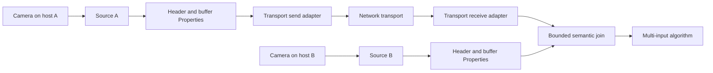
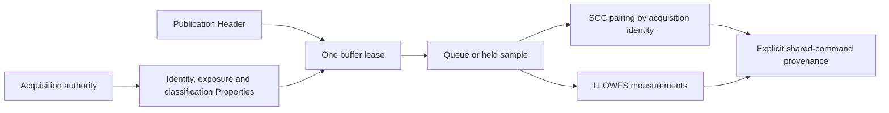

\page page_acquisition_metadata Acquisition identity and multi-host timing

# Acquisition identity and multi-host timing

## Status and authority

This document defines the PipeWireAO acquisition identity, timing, and join
contract. It applies to complete frames and to complete row-block ndarray
micro-buffers. It does not make the PipeWire scheduler a semantic join engine.

The key words **MUST**, **MUST NOT**, **REQUIRED**, **SHALL**, **SHALL NOT**,
**SHOULD**, **SHOULD NOT**, **RECOMMENDED**, **NOT RECOMMENDED**, **MAY**, and
**OPTIONAL** in this document are to be interpreted as described in BCP 14
(RFC 2119 and RFC 8174) when, and only when, they appear in all capitals.

`spa/include/spa/buffer/meta.h` is the ABI authority. This document is the
semantic authority. A transport profile defines its own encoding and carriage,
but it MUST NOT change these field meanings.

## System boundary

PipeWire graph scheduling answers when a runnable node may process. It does not
decide whether buffers from independent cameras describe the same physical
acquisition. That decision belongs to a bounded semantic join.



The same contract applies when both sources are local; the encode, transport,
and decode steps are then absent.

## Identity contract

The acquisition identity is the exact tuple:

```text
(domain, generation, sequence)
```

- `domain` is a nonzero, opaque 128-bit identifier for one acquisition or
  trigger authority.
- `generation` is a 64-bit epoch assigned by that authority.
- `sequence` is the 64-bit acquisition number within that generation.

**ACQ-ID-001:** Producers that claim a shared identity domain **MUST** receive
`domain` and `generation` from the same control-plane authority and **MUST**
derive `sequence` from the same physical trigger or acquisition counter.

Verification: configure two simulated hosts with the same authority values and
prove that equal physical acquisitions compare equal while a changed domain,
generation, or sequence compares unequal.

**ACQ-ID-002:** A producer **MUST NOT** advance a shared generation because of
its own pause, restart, packet loss, or local process lifecycle. Before a
sequence can reset, wrap, or be reused, the authority **MUST** distribute a new
generation to every participant. If the producer observes a non-increasing
sequence for a newly completed physical acquisition without that reconfiguration,
it **MUST** fail closed and stop publishing valid identity. Re-publication of a
retained acquisition preserves its identity; a new publication Header does not
claim a new physical acquisition.

Verification: inject a duplicate or reset sequence and prove that the producer
does not publish a new locally invented identity tuple.

Exact identity is independent of clock synchronization and is the preferred
join key. A PTP timestamp is a fallback for sources without a common hardware
counter and a consistency check for sources that have one.

## Per-buffer representation

This section is the target contract for the complete migration. Its implementation
and qualification gates are tracked below; the published 1.7.3 cohort still uses
the superseded Acquisition record. The replacement is standard `SPA_META_Header`
and the existing `SPA_META_Properties` BufferProperties Object, version 1.
Metadata IDs 11 and 12 remain retired and MUST NOT be reused. No Acquisition
version, compatibility reader, or version-selection flag remains in the new
runtime cohort. This changes the ndarray callback ABI and requires a coordinated
native/bindings/application release; it is not an SDK replacement for old clients.

The native Header retains publication sequence, presentation time and lifecycle
flags. Acquisition identity and exposure facts are independent Properties.
A held sample retains its acquisition tuple while each publication advances
Header sequence and presentation time. Equality of these sequence numbers is
not a general metadata invariant. Header PTS MUST NOT substitute for physical
exposure start.

The following keys extend the existing Object without changing existing keys or
the Object version. POD Bytes containing an unsigned integer use exactly eight
little-endian bytes, covering the entire UInt64 range. They are values inside a
native POD Object, not a cross-host encoding of the whole Object.

| Key | Name | POD type | Meaning |
| --- | --- | --- | --- |
| 1 | `opticalClassification` | Id | Independent absent/unfringed/fringed/mixed optical fact, values 0/1/2/3 |
| 2 | `triggerClassification` | Id | Independent absent/low/high/mixed electrical fact, values 0/1/2/3 |
| 3 | `acquisitionDomain` | Bytes16 | Nonzero acquisition-authority identifier |
| 4 | `acquisitionGeneration` | Bytes8 | Full unsigned authority generation |
| 5 | `acquisitionSequence` | Bytes8 | Full unsigned physical acquisition counter |
| 6 | `exposureDuration` | Bytes8 | Positive duration in nanoseconds |
| 7 | `exposureStart` | Long | Nonnegative physical exposure start in nanoseconds |
| 8 | `exposureTimebase` | Id | MONOTONIC=1 or TAI=2 |
| 9 | `timestampUncertainty` | Bytes8 | Inclusive unsigned timestamp error bound in nanoseconds |
| 10 | `ptpGrandmasterIdentity` | Bytes8 | Nonzero IEEE 1588 clock identity, preserving byte order |
| 11 | `ptpDomainNumber` | Id | IEEE 1588 domain, 0 through 255 |

**ACQ-ABI-001:** A producer MUST initialize every reused Properties allocation
before adding facts. A consumer MUST validate the complete Object before
interpreting it. Properties retain their existing 16–4096-byte, eight-byte-aligned,
64-field bounds, strict key order, exact types/sizes, zero padding and tail rules.
The ndarray aggregate metadata budget remains 4096 bytes, including Header.

**ACQ-PROP-001:** Keys 3–11 MUST carry `SPA_POD_PROP_FLAG_MANDATORY` when
present. Unknown well-formed optional keys MUST remain skippable. Unknown
mandatory keys MUST fail admission unless a consumer requirement declares
understanding. Each consumer MUST declare the facts and exact POD types it
requires; absent required keys and wrong types/sizes MUST fail before use.
Container-version support alone does not promise a particular fact is present.

**ACQ-PROP-002:** Identity keys 3–5 MUST appear together or all be absent.
Exposure-start keys 7–9 MUST appear together or all be absent. Duration is
independent. TAI additionally requires keys 10–11 with a nonzero grandmaster;
MONOTONIC MUST NOT include PTP keys. PTP keys without a start are invalid.
Classification absence differs from a present absent-classification value.
Partial groups and invalid ranges MUST fail complete-record validation.
Private builders may append a group incrementally; incomplete objects MUST NOT
be published or accepted by readers. Append helpers perform structural checks
while complete validation also checks semantic groups.

**ACQ-PROP-003:** Unchanged pass-through MUST preserve all validated Properties,
including unknown optional fields, under the original buffer lease. Derived
outputs MUST use explicit scientific provenance; a sum MUST NOT invent one
camera's identity for the combined command. Output reuse MUST clear stale facts.
Header publication identity and retained acquisition identity MUST remain distinct.

**ACQ-TRIGGER-001:** Trigger Id values classify the electrical state over the
whole exposure. Optical classification MUST NOT be inferred from electrical
polarity by a generic transport. An optical application relating them MUST supply
its explicit mapping, including absent and mixed states.

**ACQ-TRIGGER-002:** Chopped pairing MUST require complete acquisition identity,
positive duration and explicit usable optical classification. It MUST validate
same authority/generation, adjacent acquisition counters, compatible duration,
and alternating fringed/unfringed roles. Duplicates, stale records and gaps
MUST follow the existing bounded SCC reset/rejection policy, independently of
Header publication counters. Missing metadata MUST NOT be reconstructed from
arrival order or from a missing property treated as zero.

**ACQ-TRIGGER-003:** The new cohort MUST neither negotiate nor publish the retired
metadata type 11. Old-schema-only peers MUST fail required-Properties negotiation
or semantic admission, rather than silently running with missing identity/timing.

Verification: full-range unsigned round trips; malformed types/sizes/flags,
partial groups and padding; buffer reuse; required-key rejection; held-sample
publication/acquisition divergence; all electrical/optical classifications;
and chopped loss/restart/duplicate tests. Native callbacks expose borrowed
Properties and Header, without the old by-value Acquisition record.

### Public native helper vocabulary

`spa_acquisition_identity` and `spa_exposure_start` are owned semantic values,
not separately versioned wire records. `spa_meta_properties_get_acquisition_identity`,
`spa_meta_properties_get_exposure_start` and
`spa_meta_properties_get_exposure_duration` read validated facts.
`spa_meta_properties_add` accepts explicit property flags;
`spa_meta_properties_add_uint64` and `spa_meta_properties_get_uint64` implement
the eight-byte unsigned representation. `spa_acquisition_identity_equal`,
`spa_exposure_start_time_difference` and `spa_exposure_start_times_match` preserve
the identity, clock and saturating comparison rules below. No old-name aliases
are introduced.

## PTP-qualified time

A cross-host exposure timestamp has all of these properties:

- `exposureStart` is the physical exposure start expressed as
  nonnegative Linux `CLOCK_TAI` nanoseconds;
- `timebase` is `TAI`;
- the complete exposure-start and PTP property groups are present;
- `ptpGrandmasterIdentity` is the nonzero IEEE 1588 grandmaster clock identity;
- `ptpDomainNumber` is the IEEE 1588 domain number; and
- `timestampUncertainty` is a conservative inclusive error bound.

**ACQ-TIME-001:** A producer **MUST** use
the TAI exposure-start property group only when the device timestamp
is traceably mapped to `CLOCK_TAI`. The mapping **MUST** account for the PTP
timescale and UTC offset. A disciplined `CLOCK_MONOTONIC`, host arrival time,
buffer completion time, or unqualified device tick is not a substitute.

Verification: compare the reported exposure time against a qualified hardware
timestamp source while exercising the configured PTP profile.

**ACQ-TIME-002:** `timestampUncertainty` **MUST** bound device timestamp
resolution, exposure-latch error, device-to-PHC conversion error, PHC-to-TAI
correlation error, and the accepted synchronization error. If no defensible
bound is available, the producer **MUST NOT** publish a PTP-qualified group.

Verification: measure each error term or obtain a guaranteed bound, record the
sum used by the producer, and test the bound during steady state and recovery.

**ACQ-TIME-003:** After loss of synchronization, an unbounded clock step, an
unknown UTC offset, or an unqualified grandmaster change, the producer **MUST**
stop publishing PTP-valid time and **SHOULD** mark the next recovered output
`SPA_META_HEADER_FLAG_DISCONT`.

Verification: inject each loss condition and prove that no PTP-valid record is
published until qualification recovers.

Two exposure-start values are comparable only when both records validate, both
are PTP-qualified TAI values, and their grandmaster identities and PTP domain
numbers are byte-for-byte equal. The helper
`spa_exposure_start_time_difference()` enforces these preconditions and
returns:

```text
difference = exposure_start_a - exposure_start_b
combined_uncertainty = saturating_add(uncertainty_a, uncertainty_b)
```

Host location, clock servo name, and similar wall-clock readings are not part
of the comparison.

## Join contract

**ACQ-JOIN-001:** A join **SHOULD** match an exact acquisition identity first.
It **MAY** use PTP time when identity is absent, or use it to reject an
identity match that violates a configured physical-time bound.

**ACQ-JOIN-002:** A time-based join **MUST** choose an application-specific
additional tolerance `T` and may match only when:

```text
abs(difference) <= combined_uncertainty + T
```

The addition is saturating. `spa_exposure_start_times_match()` implements
this test. `T` does not replace the reported uncertainty and **SHOULD** be less
than half the minimum acquisition interval so adjacent acquisitions cannot
match under nominal conditions.

**ACQ-JOIN-003:** A join **MUST** have bounded per-input storage, a deadline,
and an explicit policy for missing, late, duplicate, and ambiguous inputs. The
policy may drop, hold the last value, or emit an incomplete result, but a
non-real-time input **MUST NOT** retain an unbounded number of RTC buffers.

Verification: cover exact matches, different identity fields, matching and
different PTP authorities, the uncertainty boundary, adjacent acquisitions,
duplicates, missing inputs, reordering, deadline release, and overload.

## Transport boundary

SPA metadata is native shared-memory state. PipeWire does not serialize it
across hosts, and an application MUST NOT send the bytes of the native C
structure as a network protocol. The network adapter is the correct owner of
transport versioning, byte order, framing, authentication, and association
with fragmented payload data. No transport codec is exposed by the core SPA
metadata API until a concrete transport profile requires one.

**ACQ-WIRE-001:** A cross-host adapter **MUST** carry one acquisition record with
the corresponding payload according to its transport profile and **MUST**
preserve their association through loss, reordering, duplication, and
fragmentation. It **MUST NOT** copy the native C structure directly onto the
wire.

**ACQ-WIRE-002:** A receiving adapter **MUST** decode the transport record,
construct native metadata through the public Properties helpers, and validate
it before publishing local Header and Properties. Invalid or missing records
**MUST NOT** be synthesized from packet arrival time.

Verification belongs to the selected transport implementation. It must include
golden vectors and round trips on both endian architectures where available,
then exercise loss, reordering, duplication, fragmentation, and malformed
records.

## Capability and migration gates

Hardware PTP qualification and cross-host codecs are not established by local
SPA transport tests. Device adapters must migrate their producers separately
before using the new runtime cohort; missing facts cannot be manufactured.

| Gate | Required evidence | Status |
| --- | --- | --- |
| Semantic and native contract | Identity/range/clock/hold rules and additive keys reviewed | Reviewed; native boundary independently reviewed |
| Native transport and queues | No retired record IDs; private-core Properties preservation, mismatch/reuse/fanout tests | Native focused tests and 17 queue tests pass |
| Julia and Rust bindings | Regenerated ABI; no version selection or legacy transport readers | Rust tests pass; Julia integration in progress |
| Scientific algorithms and HIL | Version-free chopping, joins, commands and held identities; zero-allocation warmed transport | Semantic tests pass; complete transport validation in progress |
| RTC, capture, GUI and applications | New-schema-only source→queue→RTC→DM→GUI/capture, cold schemas and pins updated | Pending |
| Retirement | Independent review, old-schema rejection, full dependency-cohort validation and release | Pending |

## Delivery plan and identifier preflight

Native baseline `15525f80f`, PipeWireAO.jl `687d420`, JFG `68df2f5`, HIL `d676abc`,
RTC `f7923eb`, Rust `e362a2c`, queue plugins `975c553`, GUI `a7ea558`, and instrument
monorepo `37dc272` are isolated on `codex/metadata-migration` worktrees. Pre-existing
checkouts and running unrelated sessions remain untouched. Simulators and GUI
for this work remain stopped; integration uses private cores and bounded fixtures.

The dependency order is native helpers/callback ABI and queues, regenerated
Julia/Rust bindings, scientific adapters and HIL, then RTC/GUI/capture and authored
instrument configuration. Only a complete validated replacement cohort is
published; no v2 intermediate is a delivery. Frozen scientific calibration bytes
and historical capture bytes are not hand-edited. Raw logs/builds are temporary.

The following flow preserves publication and acquisition as separate facts:



| Vocabulary | Authority and scope |
| --- | --- |
| Header, Properties, POD Id/Long/Bytes, mandatory flags | Adopted SPA metadata/POD boundary; existing Object contract |
| acquisition domain/generation/sequence | ACQ-ID-001/002; full-width physical authority identity |
| exposure start/duration, uncertainty, PTP grandmaster/domain | ACQ-TIME-001/002/003 and existing IEEE 1588 qualification semantics |
| optical/trigger classifications | Existing independent key 1/2 contract; no inferred mapping |
| publication sequence | Standard Header plus established held-sample contract; not an acquisition alias |

Existing ACQ-ID/TIME/JOIN/WIRE requirement identities and meanings remain intact.
ACQ-ABI and TRIGGER clauses now define the replacement boundary; ACQ-PROP clauses
make extensibility and complete semantic groups explicit. The native header is
implemented against this authority, not used to invent competing terminology.
