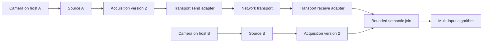

\page page_acquisition_metadata Acquisition identity and multi-host timing

# Acquisition identity and multi-host timing

## Status and authority

This document defines the PipeWireAO acquisition identity, timing, and join
contract. It applies to complete frames and to complete row-block ndarray
micro-buffers. It does not make the PipeWire scheduler a semantic join engine.

The key words **MUST**, **MUST NOT**, **REQUIRED**, **SHALL**, **SHALL NOT**,
**SHOULD**, **SHOULD NOT**, **RECOMMENDED**, **NOT RECOMMENDED**, **MAY**, and
**OPTIONAL** in this document are to be interpreted as described in BCP 14
(RFC 2119 and RFC 8174) when, and only when, they appear in all capitals.

`spa/include/spa/buffer/meta.h` is the ABI authority. This document is the
semantic authority. A transport profile defines its own encoding and carriage,
but it MUST NOT change these field meanings.

## System boundary

PipeWire graph scheduling answers when a runnable node may process. It does not
decide whether buffers from independent cameras describe the same physical
acquisition. That decision belongs to a bounded semantic join.



The same contract applies when both sources are local; the encode, transport,
and decode steps are then absent.

## Identity contract

The acquisition identity is the exact tuple:

```text
(domain, generation, sequence)
```

- `domain` is a nonzero, opaque 128-bit identifier for one acquisition or
  trigger authority.
- `generation` is a 64-bit epoch assigned by that authority.
- `sequence` is the 64-bit acquisition number within that generation.

**ACQ-ID-001:** Producers that claim a shared identity domain **MUST** receive
`domain` and `generation` from the same control-plane authority and **MUST**
derive `sequence` from the same physical trigger or acquisition counter.

Verification: configure two simulated hosts with the same authority values and
prove that equal physical acquisitions compare equal while a changed domain,
generation, or sequence compares unequal.

**ACQ-ID-002:** A producer **MUST NOT** advance a shared generation because of
its own pause, restart, packet loss, or local process lifecycle. Before a
sequence can reset, wrap, or be reused, the authority **MUST** distribute a new
generation to every participant. If the producer observes a non-increasing
sequence without that reconfiguration, it **MUST** fail closed and stop
publishing valid identity.

Verification: inject a duplicate or reset sequence and prove that the producer
does not publish a new locally invented identity tuple.

Exact identity is independent of clock synchronization and is the preferred
join key. A PTP timestamp is a fallback for sources without a common hardware
counter and a consistency check for sources that have one.

## Metadata versions

`SPA_META_Acquisition` keeps metadata ID 11 and a 96-byte, 8-byte-aligned allocation in all
three versions. Metadata ID 12 remains retired.

| Version | Exposure time | Cross-host use |
| --- | --- | --- |
| 1 | Host-local `CLOCK_MONOTONIC` nanoseconds | Never comparable across hosts |
| 2 | Explicit `MONOTONIC` or `TAI` timebase | Comparable only with valid matching PTP provenance |
| 3 | Version 2 time semantics plus trigger classification | Same PTP requirements as Version 2 |

Version 2 reuses Version 1 reserved storage without changing allocation size.
Version-aware readers accept all three versions. A Version 2 producer and consumer
negotiate `SPA_META_FEATURE_ACQUISITION_VERSION_2`; an older Version 1 reader
must not silently receive Version 2 metadata.

**ACQ-ABI-001:** A producer **MUST** initialize every reused allocation with
`spa_meta_acquisition_init()` before setting fields. A consumer **MUST** call
`spa_meta_acquisition_is_valid()` before interpreting a mapped value.

Verification: ABI tests check size, alignment, field offsets, reserved bytes,
version negotiation, malformed records, and Version 1 and Version 2 compatibility.

### Version 3 trigger classification

**ACQ-TRIGGER-001:** Version 3 **MUST** encode trigger classification in the
`reserved2` word at byte offset 88: absent = 0, low = 1, high = 2, mixed = 3.
All upper bits **MUST** be zero. Version 1 and Version 2 **MUST** retain a zero
`reserved2` word. Absent means no classification was supplied; low and high
classify the acquisition's trigger level, and mixed means the acquisition
contains both levels. Classification does not alter identity or timing.

**ACQ-TRIGGER-002:** Version 3 **MUST** apply every Version 2 clock, PTP,
validation, comparison, and timestamp-setter rule. The trigger setter **MUST**
upgrade a valid Version 2 record to Version 3 and **MUST** reject Version 1 and
malformed records without modifying them. The getter **MUST** reject malformed
records and return absent for valid Version 1 and Version 2 records.

**ACQ-TRIGGER-003:** Initialization and default producers **MUST** remain at
Version 2. `SPA_META_FEATURE_ACQUISITION_CURRENT` **MUST** remain the Version 2
feature. A Version 3 endpoint **MUST** explicitly require
`SPA_META_FEATURE_ACQUISITION_VERSION_3`. The ndarray helper **MUST** select that
mandatory feature only for a Port with
`PW_NDARRAY_FILTER_PORT_FLAG_ACQUISITION_V3`; an unflagged Port **MUST** require
Version 2. Older helpers **MUST** reject this unknown flag at admission. This
opt-in **MUST NOT** change Port or callback-buffer structure layout. Flagged
Ports **MUST** reject missing acquisition metadata and Version 1/2 payloads; unflagged Ports **MUST** reject
Version 3 payloads. Empty output metadata on flagged Ports **MUST** use Version
3 with absent classification. Global initialization remains Version 2.

Verification: round-trip all classifications; reject out-of-range encodings and
nonzero Version 1/2 reserved words; check Version 2/3 PTP comparisons and setter
behavior; prove feature mismatch rejects negotiation and flagged Ports publish
Version 3 through the native protocol. `pw-test-ndarray-filter-acquisition-admission`
checks the explicit Port flag against the current library. Run that same binary
with an older library selected through `LD_LIBRARY_PATH` and
`--expect-unsupported` to verify admission rejects the unknown flag. The
`pw-test-ndarray-filter-remote` and `pw-test-ndarray-filter-acquisition-v3`
selectors prove Version 2 and Version 3 shared-memory metadata transfer,
respectively; they do not exercise a cross-host wire codec.

## PTP-qualified time

A cross-host exposure timestamp has all of these properties:

- `exposure_start_nsec` is the physical exposure start expressed as
  nonnegative Linux `CLOCK_TAI` nanoseconds;
- `timebase` is `SPA_META_ACQUISITION_TIMEBASE_TAI`;
- `PTP_REFERENCE_VALID` and `EXPOSURE_START_VALID` are set;
- `ptp_grandmaster_id` is the nonzero IEEE 1588 grandmaster clock identity;
- `ptp_domain_number` is the IEEE 1588 domain number; and
- `timestamp_uncertainty_nsec` is a conservative inclusive error bound.

**ACQ-TIME-001:** A producer **MUST** use
`spa_meta_acquisition_set_exposure_start_ptp()` only when the device timestamp
is traceably mapped to `CLOCK_TAI`. The mapping **MUST** account for the PTP
timescale and UTC offset. A disciplined `CLOCK_MONOTONIC`, host arrival time,
buffer completion time, or unqualified device tick is not a substitute.

Verification: compare the reported exposure time against a qualified hardware
timestamp source while exercising the configured PTP profile.

**ACQ-TIME-002:** `timestamp_uncertainty_nsec` **MUST** bound device timestamp
resolution, exposure-latch error, device-to-PHC conversion error, PHC-to-TAI
correlation error, and the accepted synchronization error. If no defensible
bound is available, the producer **MUST NOT** set `PTP_REFERENCE_VALID`.

Verification: measure each error term or obtain a guaranteed bound, record the
sum used by the producer, and test the bound during steady state and recovery.

**ACQ-TIME-003:** After loss of synchronization, an unbounded clock step, an
unknown UTC offset, or an unqualified grandmaster change, the producer **MUST**
stop publishing PTP-valid time and **SHOULD** mark the next recovered output
`SPA_META_HEADER_FLAG_DISCONT`.

Verification: inject each loss condition and prove that no PTP-valid record is
published until qualification recovers.

Two Version 2 timestamps are comparable only when both records validate, both
are PTP-qualified TAI values, and their grandmaster identities and PTP domain
numbers are byte-for-byte equal. The helper
`spa_meta_acquisition_time_difference()` enforces these preconditions and
returns:

```text
difference = exposure_start_a - exposure_start_b
combined_uncertainty = saturating_add(uncertainty_a, uncertainty_b)
```

Host location, clock servo name, and similar wall-clock readings are not part
of the comparison.

## Join contract

**ACQ-JOIN-001:** A join **SHOULD** match an exact acquisition identity first.
It **MAY** use PTP time when identity is absent, or use it to reject an
identity match that violates a configured physical-time bound.

**ACQ-JOIN-002:** A time-based join **MUST** choose an application-specific
additional tolerance `T` and may match only when:

```text
abs(difference) <= combined_uncertainty + T
```

The addition is saturating. `spa_meta_acquisition_times_match()` implements
this test. `T` does not replace the reported uncertainty and **SHOULD** be less
than half the minimum acquisition interval so adjacent acquisitions cannot
match under nominal conditions.

**ACQ-JOIN-003:** A join **MUST** have bounded per-input storage, a deadline,
and an explicit policy for missing, late, duplicate, and ambiguous inputs. The
policy may drop, hold the last value, or emit an incomplete result, but a
non-real-time input **MUST NOT** retain an unbounded number of RTC buffers.

Verification: cover exact matches, different identity fields, matching and
different PTP authorities, the uncertainty boundary, adjacent acquisitions,
duplicates, missing inputs, reordering, deadline release, and overload.

## Transport boundary

SPA metadata is native shared-memory state. PipeWire does not serialize it
across hosts, and an application MUST NOT send the bytes of the native C
structure as a network protocol. The network adapter is the correct owner of
transport versioning, byte order, framing, authentication, and association
with fragmented payload data. No transport codec is exposed by the core SPA
metadata API until a concrete transport profile requires one.

**ACQ-WIRE-001:** A cross-host adapter **MUST** carry one acquisition record with
the corresponding payload according to its transport profile and **MUST**
preserve their association through loss, reordering, duplication, and
fragmentation. It **MUST NOT** copy the native C structure directly onto the
wire.

**ACQ-WIRE-002:** A receiving adapter **MUST** decode the transport record,
construct native metadata through the public acquisition helpers, and validate
it before publishing local `SPA_META_Acquisition`. Invalid or missing records
**MUST NOT** be synthesized from packet arrival time.

Verification belongs to the selected transport implementation. It must include
golden vectors and round trips on both endian architectures where available,
then exercise loss, reordering, duplication, fragmentation, and malformed
records.

## eGrabber status

The eGrabber source can derive exact identity from a configured nonzero
acquisition domain, externally assigned generation, and qualified vendor event
context. It retains the last observed sequence across Pause and Start and
fails processing on a duplicate or reset sequence. A control plane must
recreate or reconfigure the source with a new shared generation before a
counter namespace can reset or be reused.

The current eGrabber timestamp mapper produces host-local header presentation
timestamps. It does not yet establish a hardware-qualified PTP exposure-start
mapping and therefore does not set the Version 2 PTP fields.

## Capability and qualification status

| Capability | Status |
| --- | --- |
| Version 1 compatibility and Version 2 ABI validation | Implemented and unit-tested |
| PTP authority comparison and uncertainty matching | Implemented and unit-tested |
| eGrabber shared-generation fail-closed behavior | Implemented and unit-tested |
| Hardware-qualified eGrabber PTP exposure timestamp | Not implemented or qualified |
| RTP, AVB, or other network carriage profile | Not implemented or qualified |
| Application-specific bounded multi-input join | Required in the consuming algorithm or join node |

The current requirement evidence is:

| Requirement | Implementation or verification evidence |
| --- | --- |
| ACQ-ID-001 | Exact tuple validation and equality tests in `test/test-spa-buffer.c` |
| ACQ-ID-002 | eGrabber non-increasing sequence tests in `test-acquisition-key.cpp` |
| ACQ-ABI-001 | C ABI, validation, export, and negotiation tests plus Rust wrapper tests |
| ACQ-TIME-001 through ACQ-TIME-003 | Contract defined; hardware producer qualification remains open |
| ACQ-JOIN-001 and ACQ-JOIN-002 | Identity and PTP comparison helpers with boundary tests in C and Rust |
| ACQ-JOIN-003 | Contract defined; consuming join implementation and overload tests remain open |
| ACQ-WIRE-001 and ACQ-WIRE-002 | Contract defined; selected transport implementation and verification remain open |

The implemented capabilities make the contract executable and prevent false
cross-host matches. A deployment may claim operational multi-host joins only
after its timestamp producer, network carriage, and join policy pass the
corresponding verification obligations above.

## Extensible per-buffer metadata: implementation plan

Status: native implementation and focused CPU validation complete against PipeWireAO 1.7.2, commit
`7a2cf5106`. Acquisition Versions 1/2/3, metadata ID 11, Header and all existing
ndarray callback structures remain unchanged. Slot 12 remains retired.

### Buffer properties contract and naming authority

This section owns the following new protocol vocabulary. `Properties` follows
SPA POD Object properties; `BufferProperties` distinguishes these per-buffer
observations from node controls and static Port properties. `opticalClassification`
records an optical classification supplied by the application. Its authority is
an explicit optical model or measurement, never an electrical trigger level.
No compatibility aliases are defined.

| Name | Numeric value / representation | Meaning |
|---|---|---|
| `SPA_META_Properties` | 13 | One bounded POD Object in the buffer lease |
| `SPA_TYPE_OBJECT_BufferProperties` | `0x40010` | Schema-defined per-buffer Object type |
| `SPA_META_PROPERTIES_VERSION` | Object id 1 | Version 1 of this contract |
| `SPA_META_FEATURE_PROPERTIES_VERSION_1` | bit 0 | ParamMeta schema capability |
| `SPA_META_PROPERTY_opticalClassification` | key 1, POD Id | Optical classification of this payload |
| `SPA_META_PROPERTY_triggerClassification` | key 2, POD Id | Electrical trigger classification, existing Acquisition trigger enum 0–3 |
| `SPA_META_OPTICAL_ABSENT` | 0 | No optical classification established |
| `SPA_META_OPTICAL_UNFRINGED` | 1 | Application classifies the payload as unfringed |
| `SPA_META_OPTICAL_FRINGED` | 2 | Application classifies the payload as fringed |
| `SPA_META_OPTICAL_MIXED` | 3 | Payload includes both optical classifications |

An absent key differs from the present Id value `SPA_META_OPTICAL_ABSENT`.
A required optical key **MUST** be present even when its value is absent.
The trigger property adopts the existing Acquisition authority and exact enum:
`SPA_META_ACQUISITION_TRIGGER_ABSENT` (0), `LOW` (1), `HIGH` (2), `MIXED` (3).
It classifies the electrical trigger during this payload's acquisition; it does
not replace canonical Acquisition identity or timing. Acquisition v1/v2 can
coexist with the typed trigger property. A missing property remains missing;
readers **MUST NOT** invent it from Acquisition v1/v2's zero reserved field.
When the property and valid Acquisition v3 coexist, their electrical values
**MUST** match. `spa_meta_properties_acquisition_is_consistent()` checks this
relation after property validation; a missing Acquisition record or trigger
property imposes no comparison, while a present invalid Acquisition fails.
The ndarray boundary checks inputs before processing and completed outputs
before publication. Acquisition v3 remains unchanged during this migration.

Electrical Acquisition v3 trigger classification and optical classification
**MUST** remain independent. An application relating them **MUST** define and
validate its mapping, including mixed and absent values. Neither this container
nor its helpers infer such a mapping. Header `seq` **MUST** equal Acquisition
`sequence` whenever both records are published with valid acquisition identity.

The allocation is 16–4096 bytes, aligned to 8 bytes, and a multiple of 8. It
contains a `spa_pod_object` followed by ascending, unique, nonzero property keys.
The Object's POD size bounds used bytes; all property padding and all unused
allocation bytes **MUST** be zero. At most 64 properties and 64 requirements are
accepted. Initial values are Bool, Id, Int, Long, Float, Double, String and Bytes;
scalar sizes are exact, Bool is 0/1, and String has one terminating NUL and no
embedded NUL. Pointers, FDs and nested containers are excluded. The optical and trigger keys
accept only Id values 0–3. Unknown well-formed optional keys **MUST** be skipped.
Unknown mandatory keys **MUST** fail unless explicitly understood through a
consumer requirement. Unknown flags, duplicates, malformed bounds, unsupported
values/types, missing required keys and required-type mismatches **MUST** fail.
`spa_meta_property_requirement` is exactly two uint32 fields, `key` and `type`.
A requirement declares understanding of that key's meaning and exact POD type;
there is no conversion or implicit default.

Negotiate `SPA_PARAM_Meta` with type 13, the bounded allocation size and mandatory
`SPA_PARAM_META_features` bit 0. Require bit 13 in
`SPA_PARAM_BUFFERS_metaType`. These standard parameters apply to `pw_stream`,
`pw_filter` and ndarray ports. The feature proves the container schema; each
consumer declares its required key/type pairs locally and validates each used
record. It does not prove a producer will supply a particular optional key.
An unsupported metadata type or schema **MUST** fail negotiation or buffer
admission. The public SPA helpers implement allocation-free construction,
validation and lookup in caller-owned storage. Initialize every reused output;
absence **MUST NOT** reuse a previous publication's value.

`pw_ndarray_filter_set_port_buffer_properties()` explicitly opts one direction
and direction-local declaration index into this contract before connect. It
copies the bounded requirement array and rejects capacities smaller than the
minimum required POD content with `-ENOSPC`; Parameter Ports are excluded. A second
configuration call replaces that declaration. Capacity zero disables the
capability only with no requirements. Existing structs, event versions and old
streams retain their ABI. The ndarray maximum capacity is 3968 bytes, leaving
room for Header and Acquisition within its existing aggregate metadata bound.
`pw_ndarray_filter_get_buffer_properties()` returns a borrowed `spa_meta`
descriptor only during the synchronous process callback. Inputs are read-only;
outputs are writable. Each opted-in output starts with an empty Object before
every callback, including callbacks with retained outputs. A producer may call
`spa_meta_properties_init()` explicitly; `spa_meta_properties_add()` appends one
bounded scalar property. Completed outputs are checked against requirements;
unavailable outputs are not published. Consumers reject malformed or incomplete
input before invoking the process callback. Output Header/Acquisition sequence
consistency is checked when properties are enabled; legacy streams retain their
previous behavior.

The buffer lease owns ndarray, Acquisition and property bytes together. Unchanged
pass-through preserves all validated properties. Derived algorithm outputs need
application-specific physical provenance; this API does not choose an input's
facts for a sum or join. Native queue transfer already copies matching negotiated
metadata types of equal size; both links must negotiate this capability. Busy
and feature-only metadata remain endpoint-local. Native POD bytes do not define
a cross-host wire encoding. GPU source/RTC/GUI trials, device qualification and
callback deadline measurements remain separate from CPU/private-core evidence.

### Validation evidence

Native branch `codex/buffer-metadata`; queue branch `codex/buffer-properties`
starts from `6dffd8dc722013ad7c62906042a230420c4e2ecc`. Validation on 2026-11-01:

- `meson setup build -Dauto_features=disabled -Dtests=enabled -Dtest=enabled
  -Dsupport=enabled -Dspa-plugins=enabled -Dexamples=disabled`; native library,
  support plugin and required private-core modules built successfully.
- `meson test -C build --num-processes 1` with `spa-test-buffer-properties`,
  `pw-test-buffers-negotiate`, `pw-test-ndarray-filter-buffer-properties`,
  `pw-test-ndarray-filter`, `pw-test-ndarray-filter-admission`,
  `pw-test-ndarray-filter-acquisition-admission`,
  `pw-test-ndarray-filter-remote`, `pw-test-ndarray-filter-acquisition-v3`,
  `pw-test-ndarray-filter-buffer-properties-remote`,
  `pw-test-ndarray-filter-fifo` and `pw-test-ndarray-filter-buffers32`: 11/11
  passed. Tests cover required fields/types, 129 malformed cases, 64-field
  limits, reset, callback borrowing, optical/electrical independence, exact
  Header/Acquisition sequence, optional-field preservation and unchanged streams.
- The same required-properties negotiation test linked against baseline
  `buffers.c` returns success for an unsupported peer and fails its assertion
  (`result=0`, expected `-ENOTSUP`). The changed implementation passes all five
  Properties negotiation cases and 256 established buffer-allocation cases.
  A missing ParamMeta remains permissive for established metadata types;
  Properties alone requires both peers to advertise support. Unmet required
  metadata masks now reject instead of falling back to default buffers. Feature
  entries cannot shift the 32-bit required-metadata mask.
- Both new native test sources passed GCC AddressSanitizer and
  UndefinedBehaviorSanitizer (`-O1 -g -fsanitize=address,undefined
  -fno-omit-frame-pointer`), including copied configuration requirements. The subsequent minimum-capacity
  admission check passed the ndarray unit and private-core property tests.
- `meson test -C build test-spa` checks the existing Header and Acquisition ABI
  and behavior; those assertions remain unchanged. Enumeration sentinel tests
  include the new metadata and Object IDs.
- Queue validation passes its byte-copy test plus private-core copy/fanout,
  copy/queue-only and MemFd lease/queue-only tests. All four optical Id values
  and unknown optional fields remain attached to their Acquisition sequence
  through retention, drops and reuse. The unmodified queue rejects the same
  required-properties private-core fixture with `-ENOTSUP`; all cores close.
  Nine existing queue Header/Acquisition/lifecycle tests pass.

The typed-trigger migration slice additionally passed six focused tests:
`spa-test-buffer-properties`, `pw-test-ndarray-filter-buffer-properties`,
`pw-test-ndarray-filter-buffer-properties-remote` and
`pw-test-ndarray-filter-trigger-properties-{v2,input-mismatch,output-mismatch}`.
These cover all four electrical values, explicit absent versus missing, exact
Id type/range, Acquisition v2 coexistence, matching v3, conflicts rejected before
input processing/output publication, and the effective default v3 output record.
The two mismatch private-core fixtures also assert no sink buffer arrives.
The same new input-mismatch unit invariant compiled against the prior native
ndarray implementation (`da0738ace`) fails because it accepts the input; the
changed implementation passes. Both new unit sources passed AddressSanitizer
and UndefinedBehaviorSanitizer again. Queue byte-copy and all three private-core
Properties fixtures passed with typed trigger preservation added; the generic
queue transfer code required no new field-specific handling.

One parallel native regression run timed out during Version 3 client teardown
**after** its successful data-receipt result. That test passed in isolation and
in the complete sequential run; no root cause is established. Minimal builds
emit an expected missing optional D-Bus-support warning. No simulator or desktop
core is used. GPU source/RTC/GUI integration, device qualification, and callback
deadline measurements remain separate evidence. Independent review is recorded
by the owning integration workstream.
Higher-rate scheduling, asynchronous joins and shared-DM attribution remain
separate work.

Final release review finding NATIVE-R1 identified that an output callback could
omit Header validity while supplying a nonzero valid Acquisition sequence.
Validation now compares the Header sequence that will actually be published,
including its zero default. The added regression failed before the fix and passed
after it with `meson test -C build pw-test-ndarray-filter-buffer-properties`;
it also accepts a valid zero Acquisition sequence with the default Header.
